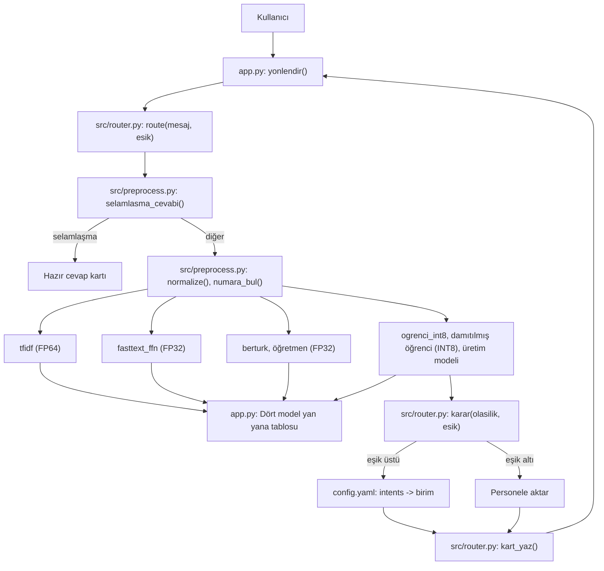

# Mimari

Her şey tek bir Python sürecinde, Mac CPU üzerinde çalışır (Apple M5). Eğitim MPS kullanır. Kutulardaki adlar koddaki dosya ve fonksiyon adlarıyla aynıdır.

Görsel hali: [architecture.png](architecture.png)

| Bileşen | Dosya | Hassasiyet | Nerede |
|---|---|---|---|
| Arayüz | `app.py` | | Mac CPU |
| Ön işleme | `src/preprocess.py` | | Mac CPU |
| tfidf | `models/tfidf.joblib` | FP64 | Mac CPU |
| fasttext_ffn | `models/fasttext.kv`, `models/ffn.pt` | FP32 | Mac CPU |
| berturk (öğretmen, 12 katman) | `models/bert/` | FP32 | Mac CPU |
| ogrenci_int8 (öğrenci, 6 katman) | `models/ogrenci_int8.pt` | INT8 | Mac CPU |
